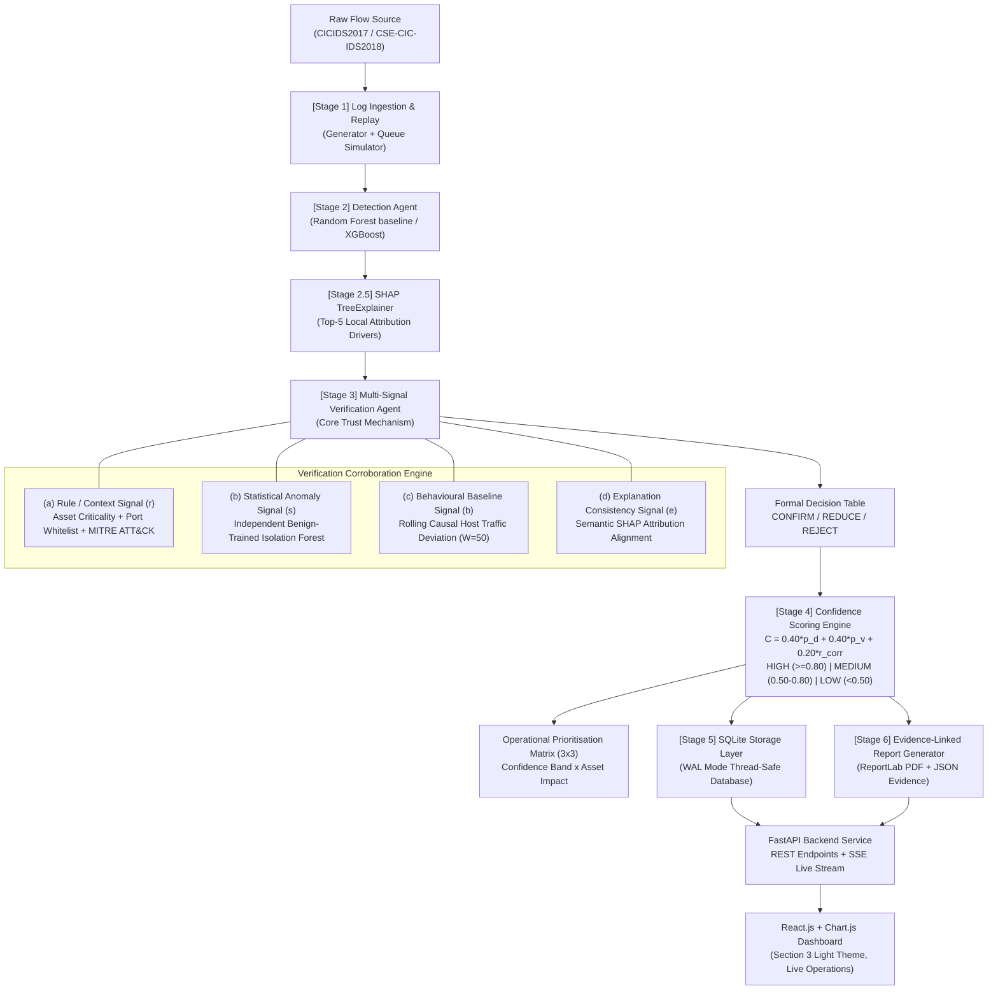

# TRUST-SOC: Architecture & System Design Document

> **System**: TRUST-SOC (Trust-Aware, Verification-Driven Detection Pipeline for Security Operations Centers)  
> **Architecture Version**: 1.0.0 (Light Theme)  
> **Status**: Production Verified (49/49 Tests Passing)

---

## 1. High-Level Architecture Overview



---

## 2. Discrete Module Responsibilities

| Module | Python Package | Primary Responsibilities | Strict Contract / Isolation Rules |
|---|---|---|---|
| **1. Log Ingestion & Replay** | `src.ingestion.log_replay` | Ingests, normalizes, and replays network flow records at controlled rates. | Never modifies raw data; wraps records in JSON schema. |
| **2. Detection Agent** | `src.detection.model` | Computes predicted class and raw confidence probability $p_d$. | Fitted on training split only; zero ground truth access at inference. |
| **3. SHAP Explainer** | `src.explainability.shap_explainer` | Extracts local directional feature attribution mass for top-5 drivers. | Computed from tree model structure; strictly explainable. |
| **4. Verification Agent** | `src.verification.verification_agent` | Evaluates 4 independent signals ($r, s, b, e$), computes $p_v$, and decides `CONFIRM`, `REDUCE`, `REJECT`. | Strictly forbidden from accessing true labels (enforced by test). |
| **5. Confidence Scoring Engine** | `src.scoring.confidence_scorer` | Fuses $p_d$, $p_v$, and $r_{\text{corr}}$ into composite confidence $C$ and assigns HIGH, MEDIUM, LOW bands. | Weights enforce $\alpha + \beta + \gamma = 1.0$; monotonic guarantees. |
| **6. SQLite Data Store** | `src.database.alert_store` | Persists alerts, reports, and cryptographic audit events. | WAL mode enabled, thread-safe dynamic connections. |
| **7. Evidence Report Generator** | `src.reporting.report_generator` | Generates audit-ready ReportLab PDFs and JSON evidence documents. | Uses ReportLab exclusively; Section 3 Light Theme strictly enforced. |
| **8. FastAPI Backend** | `src.api` | Serves REST endpoints, SSE stream, and static built React frontend. | Asynchronous endpoints, CORS configured, Swagger at `/docs`. |
| **9. React.js Dashboard** | `frontend/src` | Real-time monitoring, live replay controls, interactive Chart.js visualizations, and forensic drill-down drawer. | Pure React 19 + Chart.js, zero external UI kits, light theme tokens. |

---

## 3. Canonical Alert Schema Contract (Section 5)

Every security event traversing the TRUST-SOC pipeline conforms to the immutable Canonical Alert JSON schema:

```json
{
  "alert_id": "ALERT-D41D8CD9:42",
  "timestamp": "2026-10-26T22:00:00Z",
  "flow": {
    "source_ip": "192.168.10.50",
    "destination_ip": "172.16.0.1",
    "source_port": 49210,
    "destination_port": 80,
    "protocol": 6,
    "features": { ... }
  },
  "detection": {
    "model": "random_forest",
    "predicted_class": "DoS/DDoS",
    "probability": 0.9850,
    "class_probabilities": { ... },
    "top_features": [
      { "rank": 1, "feature": "Flow Packets/s", "shap_value": 0.342, "feature_value": 2450.2 }
    ],
    "is_alert": true
  },
  "verification": {
    "decision": "CONFIRM",
    "p_v": 0.8850,
    "signals": {
      "rule": { "score": 0.950, "strongly_contradictory": false, "details": { ... } },
      "statistical": { "score": 0.850, "strongly_contradictory": false, "details": { ... } },
      "behavioural": { "score": 0.820, "strongly_contradictory": false, "details": { ... } },
      "explanation": { "score": 0.920, "strongly_contradictory": false, "details": { ... } }
    },
    "rationale": "Strong multi-signal consensus corroborates attack without contradiction."
  },
  "scoring": {
    "composite": 0.9320,
    "band": "HIGH",
    "action": "AUTO_ESCALATE"
  },
  "audit_trail": [
    { "ts": "...", "stage": "ingestion", "event": "Ingested flow" },
    { "ts": "...", "stage": "detection", "event": "Classified DoS/DDoS (p=0.985)" },
    { "ts": "...", "stage": "verification", "event": "Verified CONFIRM (p_v=0.885)" },
    { "ts": "...", "stage": "scoring", "event": "Scored HIGH (C=0.932)" }
  ]
}
```

---

## 4. Concurrency & Thread-Safety Model

1. **SQLite Write-Ahead Logging (WAL)**: `PRAGMA journal_mode=WAL` allows non-blocking concurrent reads while background replay simulator processes transactions.
2. **Replay Simulator Threading**: Background replay simulator operates in a detached daemon thread communicating via thread-safe Python standard library queues.
3. **Server-Sent Events (SSE)**: Asynchronous FastAPI generator yields live events from memory queues to connected browser clients without blocking REST handlers.
